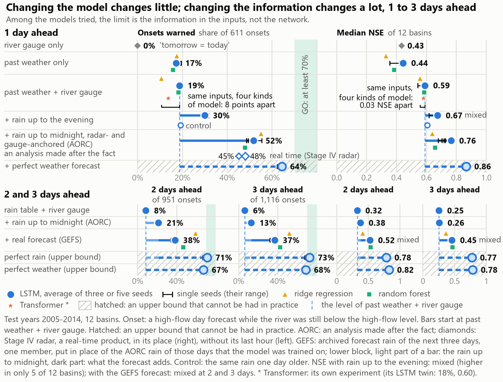

# Flood-onset warnings with an LSTM (12 CAMELS-US rivers)

A student project from a graduate course on artificial intelligence. One LSTM, shared by 12 small rivers in the
south-eastern United States, forecasts daily river flow 1 to 3 days ahead and raises a **flood warning** when the
forecast crosses the river's high-flow level. Everything here (code, results, trained networks, figures) is enough to
check every number again, without training, or to train the models again from scratch.

**The finding in one sentence:** what limits the warning is *the information the model can see by the issue time*,
not the kind of model. Same network, more information about the issue day's rain: 19% of flood onsets warned 1 day
ahead with the usual rain table, 52% with rain counted up to midnight, 64% with perfect future weather (an upper bound).

<p align="center">
  
</p>

## 0. What is the problem?

A flood warning is useful only if it comes *before* the river rises. We call the first day a river goes above its
high-flow level (the 95th percentile of flow in the training years, `Q95`) a **flood onset**, and count an onset as
**warned** when the forecast issued the day before (at local midnight) already crossed `Q95`. The test years
(2005-2014) hold **611 onsets** in the 12 rivers.

The project fixed a pass mark before looking at the test years: **GO** = at least 70% of onsets warned with at most
30% of the warnings false. Below that the verdict is **NOT YET** (or **CAUTION** when only one half is met).

## 1. What is an LSTM?

A Long Short-Term Memory network is a recurrent neural network that reads a sequence one step at a time and keeps a
memory cell whose gates (input, forget, output) decide what to remember, what to drop and what to pass on. That makes
it well suited to rivers: today's flow depends on rain that fell days or weeks ago and on how wet the ground still is.
An LSTM trained on many rivers at once ("one model for all basins") is the standard deep-learning baseline in
hydrology (Kratzert et al., HESS 2019).

## 2. Why the issue-day rain matters

The usual daily rain table of CAMELS (Daymet) closes its "day" at about 09:00 local time, so a forecast issued at
midnight never sees the afternoon and evening rain, which is when much of the storm rain falls. The experiments add the
missing hours in steps and measure what each step is worth, with the network and its settings held fixed:

| Model (all with the river gauge and 10 basin properties) | Onsets warned 1 day ahead | False share | Median NSE |
|---|---|---|---|
| Daymet rain table only (`lstm_wq`) | 18.7% (114/611) | 59.0% | 0.590 |
| + NLDAS rain (day ends about 17:30) (`lstm_wqn`) | 30.0% (183/611) | 62.7% | 0.674 |
| + ERA5 rain to midnight (`lstm_wqh`) | 29.5% (180/611) | 56.0% | 0.663 |
| + NLDAS and ERA5 (`lstm_wqnh`) | 32.4% (198/611) | 58.9% | 0.694 |
| + AORC rain to midnight (`lstm_wqa`) | **51.7% (316/611)** | 50.9% | 0.764 |
| + perfect future weather (`lstm_wqf`, upper bound) | 64.3% (393/611) | 26.0% | 0.865 |

Test years 2005-2014, warning at `Q95` itself (trigger 1.0), onsets pooled over the 12 rivers, five training seeds
(three for `lstm_wq`, `lstm_wqn` and `lstm_wqf`), seed-averaged forecasts. Sources: `results/rain_to_midnight.json`,
`results/aorc_rain_to_midnight.json`, `results/forecast_input.json` (`summary_test.sets.<set>.l1`).

Read these numbers with their limits:
- **AORC is an analysis made after the fact.** Hindsight is at most about 4 points. With Stage IV, the real-time radar
  product, in place of AORC on the issue days, the same saved networks warn of **48% (294/611)**: a check on the test
  years with the real-time radar product in place of AORC, in networks trained on AORC, not a service
  (`results/stage4_realtime.json`).
- The same AORC rain over the rain table's 09:00 window gives 18.0%: the gain comes from the clock of the rain.
- The perfect-weather model is an upper bound that cannot be had in practice. Rain alone cannot reach the 70% GO line.
- The verdict for every real model is **NOT YET**.

## 3. Architecture

- One LSTM for all 12 rivers: 64 hidden units, dropout 0.2, learning rate 0.002, batch 32, up to 2,000 updates with
  early stopping on the validation years (patience 6 checks, one check every 100 updates), sequences of 365 days after a
  365-day warm-up. About 19,000 to 26,000 trainable parameters depending on the inputs (21,400 for `lstm_wq`); CPU only. Settings chosen once on the validation years
  (`code/04_lstm_all.py`, stored in `results/lstm_all.json`) and reused unchanged by every later experiment.
- Inputs per day: the Daymet weather table, the extra rain column(s) of the experiment, the river's own observed flow
  (the gauge) and 10 static basin properties. Outputs: flow 1, 2 and 3 days ahead.
- Split: train 1980-10-01 to 2000-09-30, validation 2000-10-01 to 2005-09-30, test 2005-10-01 to 2014-09-30. Every
  choice is made on the validation years; the test years are scored once per experiment.
- Engine: `code/flood.py` (data, scaling, training, causality assertions, scoring); fairness checks with made-up rivers
  of known answer: `code/test_flood.py`.
- Yardsticks: ridge regression and random forest on engineered features (`code/02_baselines.py`, `code/features.py`),
  persistence, and a Transformer (`code/09_model_comparison.py`).

## 4. Experiments and results

Each experiment has a rule fixed before its first training (`docs/ROADMAP.md`, `docs/design/`) and an independent
review that recomputed its headline numbers from the stored forecasts (`results/review_*.json`, scripts in
`code/review/`).

| Experiment | Script | Result (1 day ahead unless stated) | Results file |
|---|---|---|---|
| E1 rain to midnight (ERA5) | `15_rain_to_midnight.py` | 19% -> 30% of onsets | `rain_to_midnight.json` |
| E1b rain to midnight (AORC) | `16_aorc_rain_to_midnight.py` | 19% -> 52%; Stage IV check 48% | `aorc_rain_to_midnight.json`, `stage4_realtime.json` |
| E2 archived weather forecast (GEFSv12) as input | `18_forecast_input.py` | 1/2/3 days ahead 52/21/13% -> 44/38/37%; no clear gain by the rule | `forecast_input.json` |
| E3 63 training rivers instead of 12 | `17_more_basins.py` | helps never-seen rivers (NSE 0.22 -> 0.39), not the 12 | `more_basins.json` |
| E4a warning level chosen on validation | `20_warning_policy.py` | 26% warned at the 30%-false point | `warning_policy.json` |
| E4b within-day rain as inputs | `21_within_day_inputs.py` | 52% -> 56%; strict seed rule not met | `within_day_inputs.json` |
| E4e river state from 15-minute gauge data | `22_flow_state.py`, `fetch_usgs_iv.py` | own split (test 2010-2014, comparable only inside it): 39% -> 47%; GO not met | `flow_state.json` |
| E7 several rain products side by side | `28_multi_product.py` | 52% -> 56% at trigger 1.0, but by a higher warning level, not better skill; not a clear gain | `multi_product.json` |

The full outcome sentence of each experiment is the `outcome` field of its results file. Scripts 01-14 (data audit,
baselines, single-river LSTM, all-river LSTM, never-seen rivers, flood analysis, maps, satellite inputs, Transformer,
rain timing, key figure, training curves, uncertainty, guide figures) are listed in `docs/PROJECT_NOTES.md`.

## 5. Repository layout

```
code/                  every script (numbered experiments 01-28, the engine flood.py, fetchers, builders)
code/review/           the independent reviewers' check scripts, one folder per experiment
results/*.json         every number, with its provenance, rule and caveats
results/models/        the trained networks (.pt), reloaded bit for bit by the checks
results/gis_layers/    basin outlines, gauges, elevation and land cover as GIS layers
results/archive/       earlier (three-seed) versions of results files, kept for disclosure
figures/               every figure, drawn by the scripts in code/
docs/                  ROADMAP (rules fixed before training), design notes, project notes, DATA.md
team.json, team_checks/  the team's own check sheet (roles only)
live_demo/             the replay page (index.html) and the numbers it prints (facts.json)
```

Not in the repository, but on the **Releases** page (`../../releases/latest`):
- `flood-onset-lstm_preds.zip` (about 1 GB): `results/preds/*.npz`, the stored forecasts every number is computed from.
- `flood-onset-lstm_data_caches.zip` (about 0.5 GB): the reduced data (basin-mean hourly AORC, ERA5, GEFS, USGS
  15-minute flow, satellite, elevation, land cover, storm tracks) that the scripts read.
- CAMELS-US itself (5 GB) comes from its official page; see `docs/DATA.md`.

## 6. How to reproduce

**Environment** (Python 3.11; the results were made on macOS and checked again on Windows 11, CPU only):

```bash
python -m venv .venv && source .venv/bin/activate        # Windows: .venv\Scripts\activate
pip install torch==2.2.2 --index-url https://download.pytorch.org/whl/cpu
pip install -r requirements.txt tzdata
export PYTHONUTF8=1                                       # Windows PowerShell: $env:PYTHONUTF8=1
```

`requirements-freeze-windows.txt` lists the exact environment of the Windows check. Run every script from the
repository root.

**Data** (details and licences in `docs/DATA.md`):
1. CAMELS-US from https://ral.ucar.edu/solutions/products/camels: `basin_timeseries_v1p2_metForcing_obsFlow.zip`,
   `basin_set_full_res.zip` and the `camels_attributes_v2.0` files, unzipped into `data/camels_us/` so that
   `data/camels_us/basin_dataset_public_v1p2/` exists.
2. Unzip `flood-onset-lstm_data_caches.zip` and `flood-onset-lstm_preds.zip` (Releases) at the repository root.

**Check, then rescore without training** (minutes):

```bash
python code/test_flood.py                      # "all checks passed": the scoring is fair on rivers with a known answer
python code/check_reload.py                    # RELOAD CHECK: PASS - a saved network rebuilds its stored forecasts
python code/16_aorc_rain_to_midnight.py --rescore   # recompute every score of an experiment from results/preds
python code/28_multi_product.py --rescore
```

**The live demo** (an interactive replay of the stored test-year forecasts, day by day; no training): `python
code/build_live_demo.py` writes `live_demo/index.html` (self-contained: open it in a browser) and
`live_demo/facts.json`. It needs the two release zips (not CAMELS-US). It recounts the onsets warned, missed and
falsely warned and the median NSE of every level from `results/preds`, checks the per-onset tables and the hourly rain
against the stored forecasts and `data/aorc`, asserts all of it against the results files, and quotes the fixed
wordings of `results/final_report_numbers.json`; a changed results file stops the build. The built page is committed:
clone or download the repository and open `live_demo/index.html` (GitHub shows .html files as source). The build is
tied to the released forecasts: after a retraining its assertions stop it on purpose. `python
code/proposal_web/shots_replay.py live_demo/index.html <outdir>` takes screenshots of it (Playwright with Chrome).

**Train again:**
- `FLOOD_QUICK=1 bash run_all.sh` is a smoke test (one seed, short training, outputs in `results/quick/`).
- **Do not run `bash run_all.sh` without `FLOOD_QUICK=1`**: a full run retrains everything and overwrites `results/`.
  Run the experiment scripts one at a time instead, e.g. `python code/21_within_day_inputs.py --seeds 5`.
  `--extend` trains only the missing (set, seed) pairs; `--rescore` trains nothing.
- One 12-river training takes about 1-2 minutes on a recent 6-core CPU (about 2 minutes on a dual-core laptop). Run
  one training script at a time. Networks retrained on another machine are new networks: expect differences of the
  size of seed noise, not identical numbers.

**Download the raw data again (optional):** `code/fetch_aorc.py` (AORC Zarr on AWS, about 4.5 GB, needs the `zstd`
command-line tool), `code/fetch_gefs.py` + `code/gefs_to_basins.py` (GEFSv12 reforecast by byte ranges),
`code/fetch_usgs_iv.py` (USGS 15-minute flow; an optional key via the `USGS_API_KEY` environment variable),
`code/check_day_windows.py` (ERA5 hourly via Open-Meteo), `code/fetch_satellite.py`. NOAA announced on 2026-04-02 that
the AORC Zarr files are being regenerated, so a new AORC download may differ slightly from the one used here (its
checksums are in `results/aorc_data.json`).

## 7. Honest limits

- Rain to midnight from AORC, ERA5 or NLDAS is known only after the fact; the real-time check (Stage IV) loses about
  4 points. No result here is an operational forecast.
- Twelve rivers, one region, one split. The onsets of one storm are not independent; the resampling intervals
  (`results/uncertainty.json`) draw water years and rivers again.
- Seeds 3 and 4 of four experiments were added after their test scores were known; each results file says so in
  `choices_made_after_looking_at_test_scores`.
- **AI use:** Claude Code (an AI coding agent) wrote and ran the code under the team lead's direction, and AI agents
  reviewed it. The team's own manual checks (`team_checks/`) were not completed.

## 8. Data credits and licence

Data: CAMELS-US (Newman et al. 2015; Addor et al. 2017, NCAR), Daymet, NLDAS-2 (NASA), AORC v1.1 (NOAA/NWS, AWS Open
Data), ERA5 (Copernicus, via Open-Meteo), Stage IV (NOAA, Iowa Environmental Mesonet archive), GEFSv12 reforecast
(NOAA, AWS Open Data), USGS Water Services, NASA POWER (IMERG, MERRA-2), SRTM elevation, USGS land cover, NOAA HURDAT2.
Each keeps its own licence and citation; see `docs/DATA.md`.

Code: MIT licence (`LICENSE`). Results, figures and documentation: CC BY 4.0. The web pages embed the Inter font (SIL Open Font
Licence 1.1) and Lucide icons (ISC); their licences are in `code/proposal_web/assets/`.
