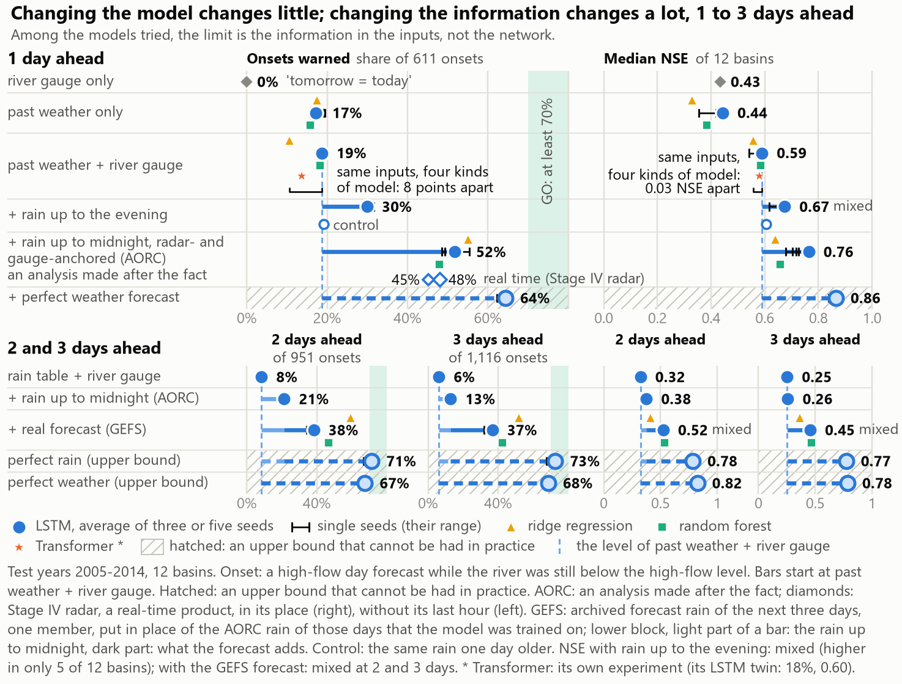

# Predicting river floods with AI

AI-course group project. **The question:** given the weather of the past year, can an AI model (an LSTM) predict a river's flow
one to three days ahead better than simple models, and warn of high-flow days before they happen? Tested on 12 river basins in
the south-eastern United States (CAMELS-US, 1980-2014).

<!-- FINDINGS: written by code/build_report.py from results/ - do not edit between these lines -->
## What we found

**Among the models tried, the limit is the information in the inputs, not the network.** With the inputs that can be had in practice, changing the kind of model changed little; giving a model more information changed a lot.



| Number | What it is |
|---|---|
| 0.59 vs 0.56 | NSE 1 day ahead with the gauge, LSTM vs best simple model: no clear difference |
| 19% | of the 611 onsets warned 1 day ahead with the river gauge: NOT YET |
| 30% | of onsets warned with rain up to the evening of the issue day (control 19%): 25% of the gap; still NOT YET |
| 51% | of onsets warned 1 day ahead with the rain up to midnight from AORC, an analysis made after the fact (control 18%; hindsight at most about 3 points; 48% with Stage IV: a check on the test years with the real-time radar product in place of AORC, in networks trained on AORC, not a service); still NOT YET |
| 39% / 37% | of onsets warned 2 and 3 days ahead with a public weather forecast beside that rain, against 8% / 6% with the rain table alone; still NOT YET |
| 64% | of onsets warned 1 day ahead given a perfect weather forecast, an upper bound |

Milestone 2 of the plan (the LSTM beats the baselines, or we learn why not): not met with the river gauge (no clear difference); with past weather only the three-seed average is ahead in most basins, a single training is not clearly ahead; why: report sections 4.3 to 4.5. The warnings of an onset cannot be trusted yet. A negative result, reported as it is; what it shows is what limits the forecast. The details are on page 1 of `Flood_Report.pdf`, the conclusions with their evidence in its section 8.
<!-- END OF FINDINGS -->

## Start here

| File | What it is |
|---|---|
| `Flood_Report.pdf` | The report. Page 1: the finding and the key figure. Section 8: conclusions, limits, next steps. Section 9: who did what, and how to reproduce. |
| `Flood_Report_3pages.docx`, `Flood_Report_3pages.pdf` | The report as a formal scientific paper in exactly three A4 pages, the hand-in form (`Flood_Report.pdf` stays the detailed record): title, authors (the four roles of the plan until `team.json` has names), abstract and keywords, numbered sections (introduction, data and methods, results, discussion, conclusion), two three-line tables (the data products; the ladder of inputs at 1, 2 and 3 days ahead), two figures (the flow of the data; the key figure), author contributions and use of AI, and references in the style of GB/T 7714-2015. The `.docx` is the editable Word copy and the `.pdf` its twin, printed from the same text. Built by `code/build_report_paper.py`; the format it follows (GB/T 7713.2-2022, GB/T 7714-2015, CY/T 170-2019) is recorded in its docstring. |
| `Flood_Report_3pages_dense.pdf` / `.html` | The dense version of the report in exactly three A4 pages (small type; `Flood_Report.pdf` stays the detailed record), kept beside the formal paper `Flood_Report_3pages.pdf`, which is the hand-in form. Page 1: the question, what was found, how it was done, and the dataset (what it is, how it was obtained, the flow of the data, how it is computed, the imagery facts; read from `results/data_flow.json`). Page 2: the key figure, the ladder of inputs as two small tables with their ranges, four short paragraphs. Page 3: what it means, the limits, the work in numbers, who did what, how to reproduce, the sources. Built by `code/build_report_short.py`. |
| `Flood_Slides.pdf`, `Flood_Slides.pptx` | The 10-minute talk. Present from the PDF (the version checked page by page); the PPTX is the editable copy with the speaker notes. |
| `Flood_Slides_5.pdf`, `Flood_Slides_5.pptx` | The 10-minute talk in five slides, the hand-in form (`Flood_Slides.pdf` stays the detailed record): the question and the fair test; the dataset (what the eleven products are, how they were obtained, the flow, how it is computed and the imagery facts, from `results/data_flow.json` and `figures/data_flow_talk.png`); the key figure; the number to beat and what more information did (one slide, one speaker, the whole ladder in one table); the conclusions, the limits and the work in numbers. Four members, one to two parts each. Present from the PDF; the PPTX is the editable copy with the speaker notes; the notes are also in `slides_notes_5.md`. Built by `code/build_slides_short.py`. |
| `Presentation_Plan_full_deck.pdf` / `.md` | For the four members, for the full 13-slide deck: who presents which slide of the talk, for how long and with which hand-over sentence; each member's part, what to be ready to answer, the backup slides, the rehearsal and what everyone says about who wrote the code. The `.md` is the copy to edit. |
| `Presentation_Plan.pdf` / `.md` | The plan handed in, for the five-slide talk: who presents which part, for how long, the hand-over sentences, the questions of `Professor_QA.pdf` that belong to each member's part, where the detail is in the full deck, the rehearsal and the honesty line. Built by `code/build_presentation_plan_short.py`. |
| `Project_Guide.pdf` | The project step by step, for readers who are new to machine learning: the machine-learning concepts the project needed, each explained where it was first used, with the project's graphs. |
| `short_report.md` | The one-page version of the report. |
| `Project_Overview.pdf` | The project on one page. |
| `Project_in_Plain_Words.pdf` | The project on one page for a reader with no background in machine learning or river science (a family member, a classmate from another department): the question, the data, what was built, what was found as a bar chart, what it means, who did it. |
| `PLAN.md` | The plan, what was done, and the milestone that was not met. |
| `ROADMAP.md`, `NEXT_STEPS_FOR_AGENTS.md` | What to do next (written 2026-10-07): what the forecast is missing, which data can be had from this laptop, what each step costs, the experiments in order; and the work order with the rules every experiment follows. |
| `NEXT_EXPERIMENTS_2026-10-28.md` | The work order for the next training round (28 October 2026): six experiments in order - warning level and stacker on stored forecasts, within-day AORC rain as an input, the river at the issue time from hourly USGS flow, a warning head beside the flow, all GEFS reforecast members, the LSTM on operational 2021-2025 inputs - with data checks, costs, ceilings and what not to do. The review of the separate Flood_Cloud_Model package it draws on is `handoff/extras/Flood_Cloud_Model_REVIEW_2026-10-28.md`. |
| `code/flood.py`, `code/test_flood.py` | The rules every experiment follows, and the checks that they are fair. |

For the team (rehearsal sheets; `make_handin_zip.sh` leaves them out unless asked): `Professor_QA.pdf` / `.md` (the questions the
professor may ask, with answers and the trap in each) and `slides_notes.md` (who says what, and for how long).
`team.json` holds the names of the team and the state of each member's own check; the team fills it in by hand.

The report, the guide, the slides, the question sheet and the overview are built by code: every number in them is read from `results/`
when the document is built. `PLAN.md` and this file are written by hand, except the block *What we found* above.

## Run it

```bash
pip install -r requirements.txt     # once, in a fresh environment (Python 3.11; torch and numpy are pinned as a pair)
python code/build_report.py         # the report again from results/ and figures/; needs no data (the PDF needs Chrome or Edge)
python code/test_flood.py           # the fairness checks on made-up data; needs no data
FLOOD_QUICK=1 ./run_all.sh          # every script in a few minutes with tiny budgets; writes to results/quick and figures/quick
./run_all.sh                        # everything from the raw data, about 8 hours on a two-core laptop (4 before the experiments of 7-8 October 2026 were added)
```

`FLOOD_QUICK=1` output means nothing; it only shows that every script still runs. (The data audit and the satellite download
have no quick mode: they rewrite their own files unchanged.) The training scripts take a lock (`.cpu_lock`), so only one of
them trains at a time. On the project laptop the environment is `~/AI_Class/.venv`; do not upgrade torch or numpy there.

Check one headline number yourself (needs `results/preds` and `data/derived`; about 3 seconds):

```bash
cd code && python -c 'import flood as F; s = F.evaluate(F.load_preds("lstm_wq"), F.thresholds(F.load_data()))["summary"]["l1"]; print(s["nse_median"], s["onset"]["pod"])'
```

It prints the median NSE and the share of onsets warned, 1 day ahead, of the LSTM with the river gauge: the two numbers of
page 1 of the report.

## What is where

```
code/      common.py (paths, chart style)   camels.py (reads CAMELS)   flood.py (the shared engine)   test_flood.py (fairness checks)
           01_data_audit.py ... 14_guide_figures.py, check_*.py   one script per question; each writes results/*.json and figures/*.png
           build_report.py + report_sections/ + report_common.py   build_slides.py   build_qa.py   build_overview.py   team.py
           build_guide.py + guide_sections/ + guide_common.py   the step-by-step guide
           warning_policy.py  subdaily_inputs.py  fetch_usgs_iv.py   added 2026-10-28 (see NEXT_EXPERIMENTS_2026-10-28.md): warning rules and a stacker on stored forecasts,
           within-day AORC inputs, the hourly USGS flow fetcher; results/diagnostics_2026-10-28/ holds their preliminary output
data/      camels_us/ (the public download, untouched) and caches of everything the scripts download - not part of the hand-in
figures/   every figure of the report (figures/quick/: smoke-test output, not results)
results/   every number of the report: *.json, *.csv;  preds/ (the stored forecasts of every model);  logs/ (the output of every run);
           quick/ (smoke-test output, not results)
```

| Step (in the order of `run_all.sh`) | Question | Main results file |
|---|---|---|
| `01_data_audit.py` | Which basins have a clean record? Picks the 12 by rule. | `data_audit.json` |
| `test_flood.py` | Is the test fair? Made-up rivers with a known answer. | `fair_test.json` |
| `02_baselines.py` | How good are simple models? The numbers to beat. | `baselines.json` |
| `03_lstm.py` | An LSTM for one river: tuning, memory. | `lstm_single.json`, `hparam_log.csv` |
| `04_lstm_all.py` | One LSTM for all 12 rivers, four sets of inputs, three seeds. | `lstm_all.json`, `lstm_all_scores.csv` |
| `05_lobo.py` | A river the model has never seen. | `lstm_lobo.json` |
| `07_basin_maps.py`, `fetch_satellite.py` | Elevation and land cover per basin; satellite rain and reanalysis inputs. | `basin_gis.json`, `satellite_data.json` |
| `10_rain_timing.py` | Which day does the rain table mean, and what is rain up to the evening worth? | `rain_timing.json` |
| `06_flood_analysis.py`, `check_2004_floods.py` | Could the warnings be trusted? Where and why do they fail? | `flood_analysis.json`, `flood_events.csv` |
| `08_satellite_inputs.py` | Satellite rain, soil wetness and water vapour as inputs. | `satellite_inputs.json` |
| `09_model_comparison.py` | Transformer against LSTM, and what training costs. | `model_comparison.json` |
| `check_day_windows.py` | Which 24 hours does each rain product's 'day' cover? | `day_windows.json` |
| `15_rain_to_midnight.py` | What is the rain of the whole issue day, up to local midnight, worth as an input (hourly ERA5)? Saves its trained networks to `results/models/`. | `rain_to_midnight.json` |
| `check_onset_rain_clock.py` | When did the rain of each flood onset fall, relative to the issue time: in the table, already fallen but hidden, or still to come? | `onset_rain_clock.json` |
| `fetch_aorc.py`, `16_aorc_rain_to_midnight.py`, `check_aorc_hindsight.py` | The same question with AORC hourly rain (1 km, gauge- and radar-anchored) instead of ERA5; and does that rain carry hindsight? | `aorc_data.json`, `aorc_rain_to_midnight.json`, `aorc_hindsight.json` |
| `17_more_basins.py` | Do 63 training rivers instead of 12 help the same 12 rivers, and rivers never seen? (adds about two hours to `run_all.sh`) | `more_basins.json` |
| `fetch_gefs.py`, `gefs_to_basins.py`, `18_forecast_input.py` | An archived real weather forecast (GEFSv12 reforecast rain) as an input. | `gefs_basins.json`, `forecast_input.json` |
| `12_training_curves.py` | The learning curves every training stored. | `training_curves.json` |
| `13_uncertainty.py` | How far do the headline numbers move when test years and basins are drawn again? | `uncertainty.json` |
| `check_same_misses.py` | Do the kinds of model miss the same onsets? | `same_misses.json` |
| `11_key_figure.py` | The main conclusion in one picture (it draws on the results above). | `key_figure.json` |
| `14_guide_figures.py` | Four concept pictures for the step-by-step guide. | `guide_figures.json` |

`results/engine_review.json`, `results/sources_checked.json`, `results/published_scores.json`, `results/data_access.json` (data sources
checked for access on 2026-10-07), `results/published_context.json` (published numbers behind the planned experiments) and
`results/review_*.json` (the independent checks of scripts 15, 16 and 17; the reviewers' own scripts are under `code/review/`) are records
written by the AI review, not by a script. `ROADMAP.md` holds the results of 7 October 2026 with their caveats.

The stored forecasts in `results/preds/` are named `<model>_<inputs>`: `base_persistence` ('tomorrow = today'),
`base_linreg_*` (ridge regression), `base_rf_*` (random forest), `lstm_*` (the all-river LSTM, the average of three trainings;
`_s0` to `_s2` are the single trainings), `lstm1_*` (the one-river LSTM), `lobo_*` (a river left out of training), `sat_*`
(satellite and reanalysis inputs), `cmp_lstm` and `cmp_transformer` (the cost comparison). Inputs: `w` past weather,
`wq` + river gauge, `wf` + perfect weather forecast (an upper bound), `wqf` both, `wn` / `wqn` + rain stamped up to the evening
of the issue day, `wh` / `wqh` + rain up to local midnight of the issue day (hourly ERA5, 15_rain_to_midnight.py), `_older` the control with the
same rain one day older. `results/models/` holds the trained networks of script 15 (one file per training; reloading reproduces the stored forecasts).

## Data (not in the hand-in zip)

Two downloads of 7 October 2026 need more than the Python packages: `code/fetch_aorc.py` (AORC hourly rain, 4.5 GB read, 12 small files
kept under `data/aorc/`) needs the `zstd` command-line tool; `code/fetch_gefs.py` (GEFSv12 reforecast rain, 48 GB read, 141 MB kept under
`data/gefs/`) runs in a separate environment `~/AI_Class/.venv-grib` (eccodes, cfgrib, xarray) because the GRIB reader is not in the
project environment; `code/check_stage4_realtime.py` fetches Stage IV radar files from the Iowa Mesonet archive (16 GB read, one CSV kept).
All three are resume-safe and are not part of `run_all.sh`.

`data/camels_us` is the public CAMELS-US download (Newman et al., 2015; Addor et al., 2017): `basin_timeseries_v1p2_metForcing_obsFlow.zip`
and `basin_set_full_res.zip`, unzipped in place, and the seven `camels_*.txt` attribute tables. Everything else under `data/`
(satellite rain, elevation, land cover, storm tracks, hourly rain) is downloaded and cached by the scripts on their first run.

`./make_handin_zip.sh` writes the hand-in archive next to the project folder: light (documents, code, figures, results) or
`./make_handin_zip.sh full` (plus the stored forecasts, so that every number can be re-scored without training).

## Who did what

The plan names Claude Code as the team's coding assistant. All code was written and all experiments were run by Claude Code
under the team lead's direction (data audit on 2 October 2026, everything else on 3 October 2026; on 4 October 2026 the day-window
check was reviewed and rerun, four analyses of the stored results were added without new training - the key figure, the
learning curves, the same-misses check and the resampling ranges - and the documents were revised; on 7 and 8 October 2026 the
four experiments of `ROADMAP.md` were built, run and reviewed - E1 and E1b (rain known up to the issue time, from ERA5 and from
AORC, with the Stage IV real-time check), E3 (63 training rivers) and E2 (the GEFS forecast as an input) - and the documents were rebuilt from the
results on 8 October 2026). Independent AI reviewer agents checked the shared engine and every experiment script (`results/engine_review.json`;
for the new experiments `results/review_*.json`, with the reviewers' own scripts under `code/review/`); the real-time check on all onsets,
the rain-clock diagnostic, the resampling ranges and the key figure of 8 October 2026 were verified by the final critic agent only
(`results/review_documents_2026-10-08.json`). The team members' own checks that the plan
assigns are listed in section 9 of the report and at the end of `Professor_QA.pdf`; they still have to be done, and
`team.json` is where a member records a finished check.
